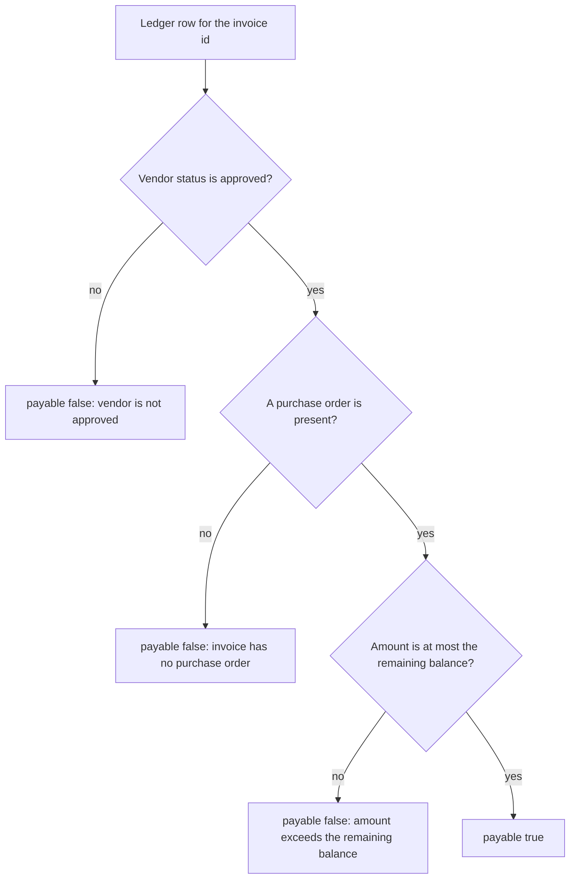
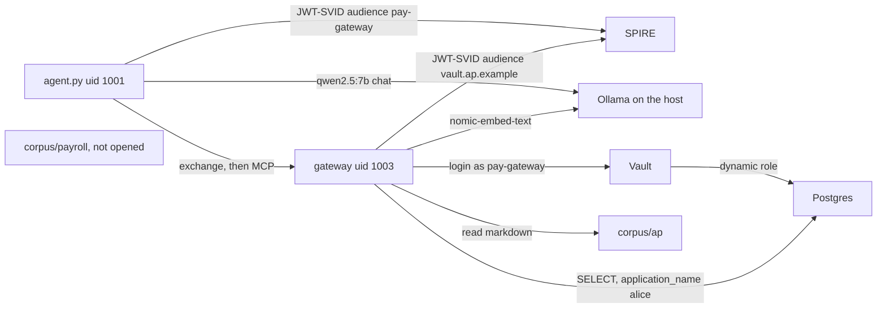
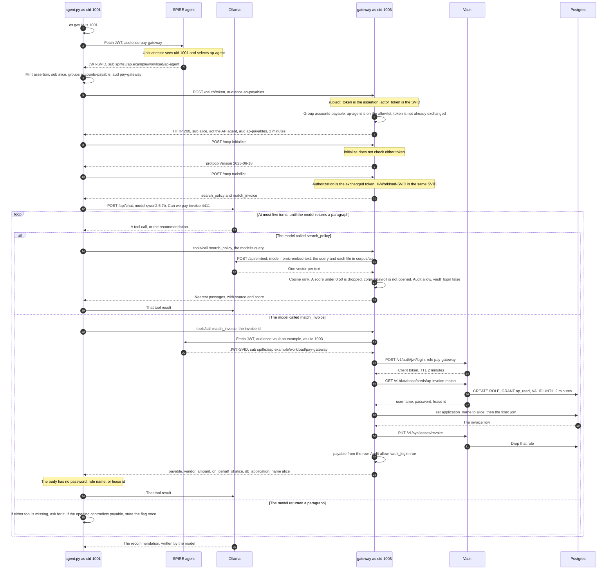
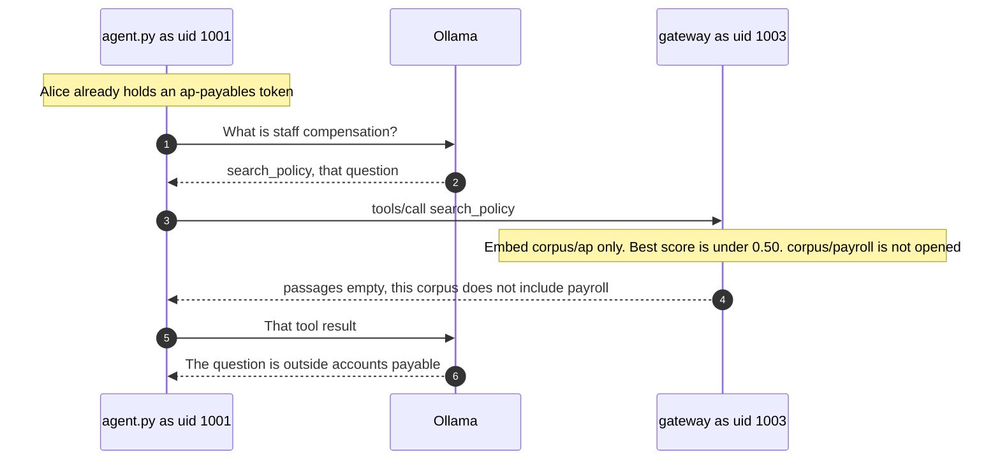

# Plain English

Alice asks, "Can we pay invoice 4411?" A correct answer names the vendor, the amount, the purchase order, and the policy clause that allowed it. This page is that call. The commands are in [Demo](./DEMO.md). The lines a run prints, and what each line means, are in [Step by step](./STEP_BY_STEP.md).

## Why the work splits in two

Accounts payable already has the rule in a document and the numbers in a ledger. Those are different systems, and the agent should not pretend one of them is the other.

The document says when a payment is allowed. Retrieval's job is to put that clause in front of the agent. The clause in `corpus/ap/ap-payment-policy.md` is: pay a vendor invoice only when the vendor is approved, the invoice cites an open purchase order, and the invoice amount does not exceed the purchase order's remaining balance. A second file in that folder describes vendor onboarding and does not authorize payment. `corpus/payroll/` is staff pay. The search root is `corpus/ap/`, so the payroll memo is never returned. That is the business boundary retrieval is enforcing. It is also why the agent's job is smaller: it applies a clause it was handed, instead of remembering the rule.

The ledger says what this invoice is. `match_invoice` runs one fixed query joining `invoices`, `vendors`, and `purchase_orders`. The agent passes an invoice id. It does not write SQL. The gateway computes payable from the row: vendor approved, purchase order present, amount at most the remaining balance. The same sentences are in the policy file. A passage cannot set `payable` to true.



## The five technologies on this call

| Piece | What it does on "Can we pay 4411?" |
|-------|-------------------------------------|
| Retrieval | `search_policy` embeds the model's query and every file in `corpus/ap/` with `nomic-embed-text`, then returns the nearest passages. The payment clause outranks onboarding and filing. `corpus/payroll/` is not embedded |
| MCP | `POST /mcp` speaks JSON-RPC. `initialize`, then `tools/list`, then `tools/call`. The list is those two tools. There is no approve-payment tool and no password tool |
| SPIFFE | The agent process is uid 1001, so the JWT-SVID is `spiffe://ap.example/workload/ap-agent`. uid 1002 is the notes bot. uid 1003 is the gateway |
| On-behalf-of | `POST /oauth/token` takes Alice's assertion and that SVID. The tool token has `sub` alice, `act` the AP agent, `aud` `ap-payables`, and group `accounts-payable` only. MCP's `Authorization` header is that token. The SVID is `X-Workload-SVID`, because MCP has one authorization slot |
| Vault | Only `match_invoice` logs in, and only as `spiffe://ap.example/workload/pay-gateway`, audience `vault.ap.example`. Vault mints a role that can `SELECT` the three ledger tables. The gateway sets `application_name` to Alice, reads the row, revokes the lease, and then builds the tool result |

`on_behalf_of` in that result is `sub` from the tool token. `db_application_name` is Postgres reading back `application_name`. Vault does not supply either field. The result has no role name, lease id, or password.



## What Alice's agent does

`qwen2.5:7b` is the clerk. The host carries identity and runs the tool the model names. The model chooses the order. On a payable invoice it has called the ledger first, then the policy, then the ledger again. Both tools have to have run before the paragraph is accepted.



Pay 4411: Northwind is approved, PO 900 has 10000 remaining, the invoice is 9800. The answer starts "Pay invoice 4411" and includes the clause.

Do not pay 4412: the invoice is 12000. The answer says the amount exceeds the remaining balance, and still quotes the clause.

Do not pay 4413: Contoso is blocked. The answer says the vendor is not approved, and still quotes the clause.

Staff compensation is the same call with a different question. Alice is still the accounts-payable caller. The model searches with "What is staff compensation?" The nearest file in `corpus/ap/` scores under 0.50, so `search_policy` returns no passage and says this corpus does not include payroll. The payroll memo is not opened. The model says the question is outside accounts payable. There is no invoice, so the ledger is not read.



## What Ollama does

Ollama is the model server on the Mac, the app at `/Applications/Ollama.app`, listening on `http://host.docker.internal:11434`. It is not a container in this compose file. Two `llama-server` processes stay up: one holds `qwen2.5:7b`, the other holds `nomic-embed-text`. The gateway and the agent are containers, and they call the host.

On this Mac the host app is the right place for the models. They are already loaded there, and the native app can use the Mac's GPU. A container would be a Linux process inside Docker Desktop, with its own copy of the weights or a mount of the same directory, and it would not see that GPU the same way. The agent would still call it over HTTP. Putting Ollama in Compose would not make it uid 1001, and it still must not hold Alice's token. A container is the right packaging when the machine has never installed Ollama and the stack should start from `bootstrap.sh` alone. That choice does not change who sends the MCP call.

It runs two models.

`qwen2.5:7b` is the clerk. `agent.py` sends the question and the tool list to `POST /api/chat`. The model returns either a tool name and its arguments, or the recommendation. On a payable invoice it has named `match_invoice`, then `search_policy`, then `match_invoice` again. On staff compensation it names `search_policy` with the question unchanged. The paragraph the demo prints is the model's own text.

`nomic-embed-text` is the retrieval model. During `search_policy` the gateway sends the model's query and each file in `corpus/ap/` to `POST /api/embed`, then ranks the vectors by cosine similarity. A score under 0.50 is dropped. That is why "What is staff compensation?" returns no passage: the nearest accounts-payable file scores about 0.45. `corpus/payroll/` is never sent.

Ollama does not decide who Alice is, and it does not log in to Vault.

## Who sends the MCP call

The model names the tool. `agent.py` sends it.

That process is uid 1001, so SPIRE issues `spiffe://ap.example/workload/ap-agent` to it. It also holds Alice's exchanged token. Those two values are the MCP request: `Authorization` is the exchanged token, and `X-Workload-SVID` is the SPIFFE JWT. The gateway checks both before it embeds a passage or reads the ledger.

Ollama is a different process, on the host. SPIRE does not attest it as the AP agent. The agent does not hand it the exchanged token or the workload JWT. The tool result is what goes back to `qwen2.5:7b`. The same process also serves `nomic-embed-text`, so a caller's token would sit in a server that answers every embedding request.

This is the usual shape of tool calling. The model server returns the call. The application that holds the credentials performs the request. If the model skips a required tool, or the opening sentence contradicts `payable`, or a staff search comes back with an accounts-payable passage, `agent.py` asks once and then sends whatever tool the model names. The sentence is still the model's.

## Calling the agent

A mode is a saved call. `pay`, `over`, `blocked`, and `staff` ask the model and end with `PASS` or `FAIL`. `engineering`, `notes`, `passthrough`, and `vault-direct` stop before the model and end the same way. The commands are in [Demo](./DEMO.md).

The flags are that same call with the person, the group, and the question written out. They print the answer or the refusal. They do not print `PASS`. The uid is still the first argument of `call.sh`, and SPIRE names the program from that uid. `--audience` changes only the audience on the workload JWT. The assertion is always minted for `pay-gateway`.

A question that contains the word invoice uses `search_policy` and `match_invoice`. Any other question searches the policy and does not read the ledger. `--passthrough` skips the exchange and posts the assertion to `match_invoice` for 4411. `--vault` skips the gateway and posts this process's SPIFFE JWT to Vault.

| You want | How to ask |
|----------|------------|
| Invoice 4411, 4412, or 4413 | `--user alice --group accounts-payable --question "Can we pay invoice NNNN?"` |
| Staff compensation | `--user alice --group accounts-payable --question "What is staff compensation?"` |
| Bob, who is not in accounts payable | `--user bob --group engineering --question "Can we pay invoice 4411?"` |
| An assertion with no group | `--user alice --question "Can we pay invoice 4411?"` |
| The notes bot holding Alice's assertion | uid `1002`, with Alice's flags |
| A workload token for the wrong audience | add `--audience mail-tool` |
| Alice's assertion, unexchanged | `--user alice --group accounts-payable --passthrough` |
| The AP agent's own JWT at Vault | `--vault` |

## What fails closed

- Bob in engineering never receives a tool token. The group on the assertion is the business role.
- The notes bot, holding Alice's assertion, is refused because the SPIFFE ID is not the AP agent.
- Alice's original assertion, presented straight to `tools/call`, is refused. It was minted for `pay-gateway`. The tools require `ap-payables`.
- The AP agent's own SPIFFE JWT, presented to Vault, is refused. The role is bound to the gateway.
- After a payable match, the dynamic role is gone from Postgres. The password was never in the tool result the agent printed.

```mermaid
flowchart TD
    call["Bob, the notes bot, a raw assertion, or the agent's own JWT"]
    call --> which{"Where it stops"}
    which -->|"Bob, group engineering"| bob["Exchange HTTP 400, accounts-payable. No audit line. The model is not called."]
    which -->|"uid 1002, notes bot"| notes["Exchange HTTP 400, allowlist. No audit line. The model is not called."]
    which -->|"Alice's assertion on tools/call"| raw["HTTP 403, not an on-behalf-of token. Audit decision block. The model is not called."]
    which -->|"AP agent JWT posted to Vault"| vault["Vault HTTP 400, invalid subject. The gateway is not on this call."]
```

## What this project is not

An approve-payment transaction, a hosted vector database, or a second audience that can read payroll. The payroll memo is there so you can see it is outside the embedding root. The model is local. `python3 -m gateway.check_rules` checks the clause, cosine ranking, the three invoice decisions, the exchange, and a live embedding search when Ollama is up.
